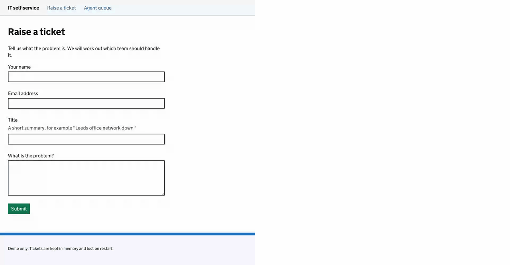

# itsm

A demo IT self-service portal. A customer describes a problem in plain
English. **jev** (TypeSafe's System One model) answers a fixed set of typed
questions about it. Go code turns those answers into a team, a severity and,
when triage can't decide, pre-written follow-up questions.

- Customer screen: <http://localhost:8080/>
- Agent screen: <http://localhost:8080/agent>

Tickets are kept in memory and are lost on restart.

## ▶ The demo



*Recorded with `make demo-gif`, which replays the answers live jev gave
for these tickets, so the latencies show as 0 ms. The script of what happens
is [below](#what-you-will-see).*

Run it yourself:

```sh
typesafe-key && make demo
```

Two browser windows open side by side and play the whole story by
themselves in about **two minutes**. The **customer** screen is on the left,
the **agent** screen on the right. Nothing needs typing and nothing needs
clicking. First time on this machine? Follow [Getting started](#getting-started).

### What you will see

The customer is always *Sam Taylor*. Every ticket appears on the agent's
queue as soon as it is raised, grey while jev is triaging, then it flips to
its team and severity.

| # | Left: customer types… | Right: agent sees… |
|---|---|---|
| 1 | The empty "raise a ticket" form. | An empty queue. |
| 2 | **Leeds office network down** — *"Nobody in Leeds office can get on the network since 9am."* | **Network, Sev 2.** One whole office is blocked. |
| 3 | **nDelius down nationally** — *"nDelius is down for everyone across the country."* | **Applications, Sev 1.** National outage: the top severity. |
| 4 | **Firewall change for print server** — *"Please open port 443 on the Leeds firewall…"* | **Network, Sev 4.** A change request, not a fault, so it is low. |
| 5 | Ticket 4: **Everything is broken** — *"Everything is broken, please help."* | **Service Desk, Sev 3, flagged for review.** jev can't tell where or what. |
|   | …the customer is asked three follow-up questions and answers them: *Bristol office*, *OASys*, *just me*. | Triage runs again and re-routes it to **Applications, Sev 3**. Still flagged. |
| 6 | **Locked out after MFA reset** — *"…can't log in to anything."* | **Identity and Access, Sev 3.** |
| 7 | **Laptop screen flickers** — *"…now and then. Not urgent."* | **End User Compute, Sev 4.** |
| 8 | — | The **decision feed**: one line per triage decision, newest last. |
| 9 | — | The **Why** panel for "Everything is broken": both triage runs side by side, with jev's confidence in each team, scope and kind, and the severity rule that fired. |
| 10 | — | The agent **marks it reviewed** (only a human clears the flag), **reassigns** the laptop ticket to Applications, **closes** the Leeds network ticket, and returns to the queue. |

The point of scene 5: when the machine isn't sure, it asks the customer the
right questions instead of guessing, and it leaves a human the final say.

### Tuning the demo

The demo talks to live jev, so the team and severity it shows can drift from
the table above. It only waits for each ticket to leave triaging; it never
checks the answer. The `e2e` test (see [Test](#test)) checks them against a
fake jev.

| Variable | Default | Meaning |
|---|---|---|
| `DEMO_SLOWMO_MS` | `1000` | Delay before each browser action. Raise it to slow typing and clicks. |
| `DEMO_PAUSE_MS` | `5000` | Pause between scenes. Raise it to give the audience longer to read. |
| `DEMO_BASE_URL` | unset | Use a server that is already running instead of starting one. |

For example, an even slower run: `DEMO_PAUSE_MS=8000 make demo`.

`make demo` builds `bin/itsm`, starts it, waits for `/healthz`, plays the
scenes, and stops the server. The windows are sized to split the display.

To re-record the GIF above after a UI change, run `make demo-gif` (needs
`ffmpeg`; no key). It plays the same scenes headless against a fake jev,
records each window, and stitches them side by side into `docs/demo.gif`.

## Getting started

From nothing to the running demo on a Mac. Paste each command on its own
line. Steps 1–4 are once per machine.

1. **Install Go 1.26** (and the linter, if you want `make check` to run
   the same checks as CI):

   ```sh
   brew install go
   go install github.com/golangci/golangci-lint/v2/cmd/golangci-lint@v2.14.0
   ```

2. **Clone and build:**

   ```sh
   git clone https://github.com/redscaresu/itsm.git
   ```
   ```sh
   cd itsm && make build
   ```

3. **Store your TypeSafe API key in the Keychain.** Paste the line, press
   Enter, then paste the key and press Enter again — nothing echoes:

   ```sh
   read -rs T; security add-generic-password -U -a "$USER" -s typesafe-api-key -w "$T"; unset T
   ```

   Check it saved (prints the key's length + 1, never the key):

   ```sh
   security find-generic-password -a "$USER" -s typesafe-api-key -w | wc -c
   ```

4. **Add the loader function to your shell** and reload:

   ```sh
   cat >> ~/.zshrc <<'EOF'
   typesafe-key() { export TYPESAFE_API_KEY="$(security find-generic-password -a "$USER" -s typesafe-api-key -w)"; }
   EOF
   ```
   ```sh
   source ~/.zshrc
   ```

5. **Prove the toolchain** — no key or network needed:

   ```sh
   make check
   ```

6. **Install the demo browser** (once; downloads the Playwright driver and
   Chromium, a few minutes):

   ```sh
   make demo-install
   ```

7. **Run the demo.** `typesafe-key` prints nothing; it loads the key into
   this shell only. If macOS asks whether to allow Keychain access, choose
   *Always Allow*.

   ```sh
   typesafe-key
   ```
   ```sh
   make demo
   ```

   Two Chromium windows open side by side and play the ten scenes in about
   two minutes (see [What you will see](#what-you-will-see)). Don't click
   in them while it runs.

To use the portal by hand instead of the scripted demo: `typesafe-key`, then
`make run`, then open the two URLs above.

**If something says `TYPESAFE_API_KEY is not set`:** run `typesafe-key` in
the same terminal window, then retry. The key lives in that shell only.

## Run

You need Go 1.26 and a TypeSafe API key (Getting started, steps 1–4).

```sh
typesafe-key          # load the key into this shell only
make run              # or: go run ./cmd/itsm
```

The server listens on `PORT` and shuts down cleanly on Ctrl-C. It waits up to
10 s for triage runs still in flight.

## Config

Environment only.

| Variable | Default | Meaning |
|---|---|---|
| `TYPESAFE_API_KEY` | none, required | Bearer token for jev. Never logged. |
| `TYPESAFE_BASE_URL` | `https://api.typesafe.ai` | jev's base URL. Tests point it at a fake. |
| `PORT` | `8080` | HTTP port. |

## Key handling

Keep the key in the macOS Keychain and load it into one shell with the
`typesafe-key` function (Getting started, steps 3–4). Never `export` it from
a shell rc file: every process started from that shell would inherit it,
which is exactly what a malicious package's install script scrapes for.

Run `typesafe-key` in the shell where you start the server, the demo or the
live test. It is per-terminal-window: a new tab needs it again.

## Test

```sh
make check            # CI's check job: vet, test -race, golangci-lint
make e2e              # CI's e2e job: the demo's ten scenes, headless, against a fake jev
                      # (needs make demo-install); checks every team and severity
go test -race ./...   # unit and end-to-end tests; no key, no network
```

`cmd/itsm/main_test.go` starts the real server with a fake jev and walks a
ticket through its whole life: raised, more information requested,
answered, re-routed, reassigned, closed.

### Live smoke test

Sends the six demo tickets, and ticket 4's follow-up answers, to the real
jev API. For each run it checks jev's team, kind and scope choices against the
table in the design doc (HLD 4.5), then the ticket's team, severity and
status. It checks the needs-review flag after the first run only; the e2e
test checks that the flag survives ticket 4's second run. It does not
compare probabilities; it logs them.
Run it by hand. It skips without a key.

```sh
typesafe-key
go test -tags live -count=1 -v ./cmd/itsm/
```

A failure means jev's answers have drifted. The test logs each run's answers.
Fix a threshold (`internal/triage/thresholds.go`) or a question
(`internal/jev/questions.go`), not the test.

## Demo data

`testdata/demo/tickets.json` holds the six demo tickets: what to type, the
expected outcome, and what live jev answered (replayed by the fake).
`internal/demodata` reads it. The live test and the end-to-end tests both use
this one file, so the typed text and the expected outcomes cannot drift apart.
